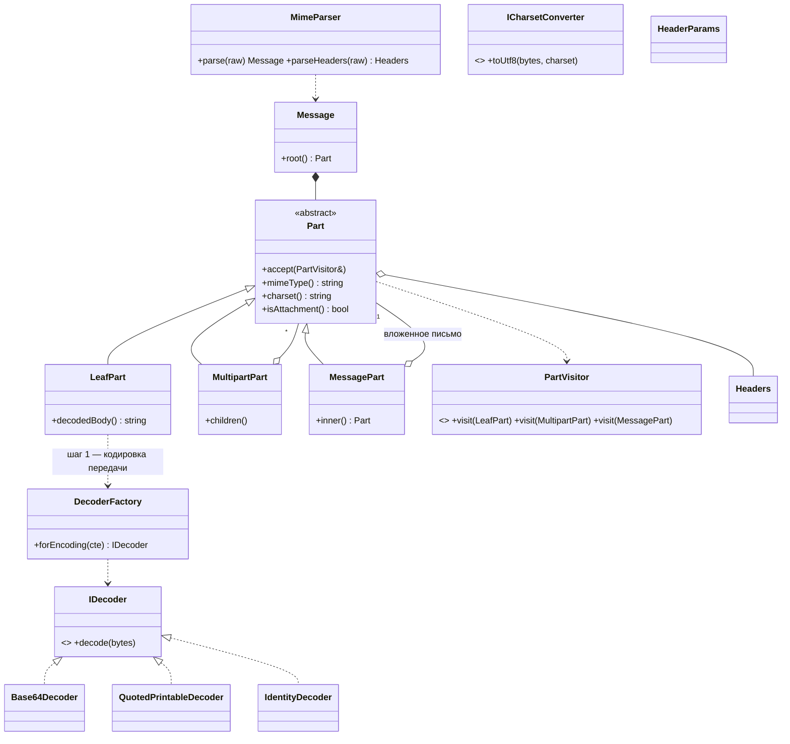
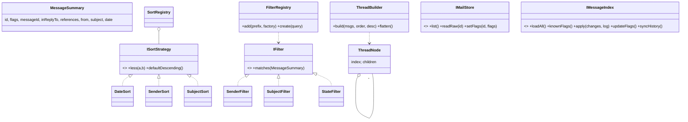
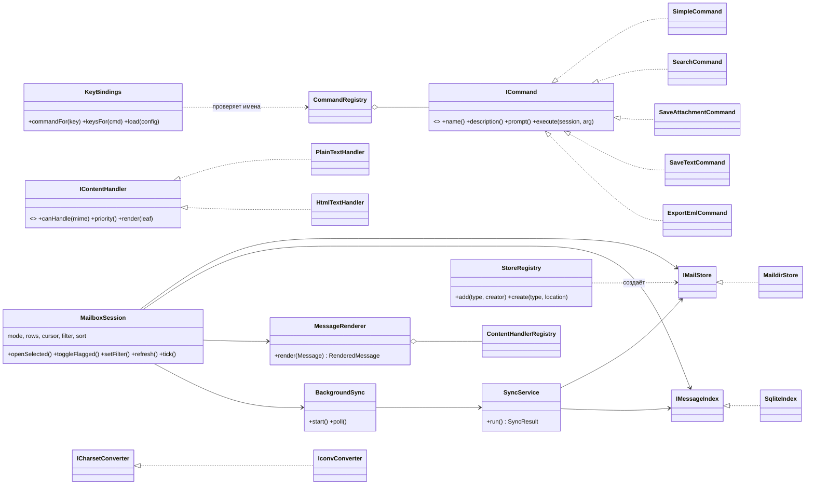
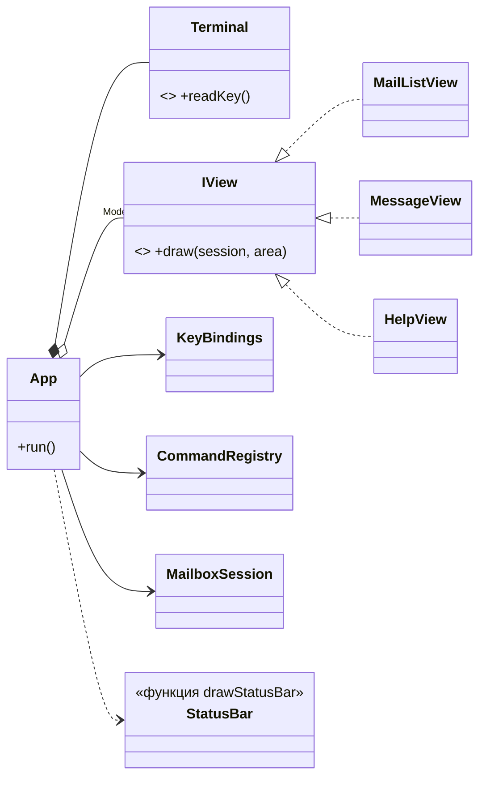

# DESIGN: устройство maills

Вариант В (почтовый клиент). Оценивается проектирование, поэтому здесь описано: слои и их границы,
классы, точки расширения «как добавить», паттерны с обоснованием и честные ограничения.

## 1. Слои и зависимости

```
 Presentation  (ncurses: App, views, терминал)          src/presentation
      │ зависит от
 Core ┌───────────────────────────────────────────┐
      │ Application: сценарии, состояние сеанса    │     src/core/application
      │   MailboxSession, команды, SyncService ... │
      │ Domain: модель и её логика, порты          │     src/core/domain
      │   письмо, MIME, декодеры, треды, IMailStore│
      └───────────────────────────────────────────┘
      ▲ реализует порты ядра
 Infrastructure  (Maildir, SQLite, iconv)               src/infrastructure
```

Правила (зависимости идут только внутрь, к ядру):

| слой | может использовать | не знает о |
|---|---|---|
| Domain | только стандартную библиотеку | Application, Infrastructure, Presentation, SQLite, iconv, терминал |
| Application | Domain | Infrastructure, Presentation |
| Infrastructure | Core (реализует его интерфейсы) | Presentation |
| Presentation | Core | Infrastructure (экземпляры ей передаёт `main.cpp`) |

Как это обеспечено:
* **CMake.** `mail_core` (Domain + Application) не линкуется ни с ncurses, ни с SQLite; `mail_presentation` линкуется с `mail_core`
  и ncurses, но не с `mail_infrastructure`. Тесты линкуются с ядром и инфраструктурой, но не с ncurses.
* **Тест `layering`** (`tests/check_layers.cmake`) читает `#include` во всех файлах и падает, если слой подключает запрещённый заголовок.
* **Корень композиции** — `app/main.cpp`: единственное место, где создаются конкретные классы (`MaildirStore`, `SqliteIndex`,
  `IconvConverter`) и передаются в ядро как интерфейсы.

Порты (интерфейсы) лежат в ядре, реализации — снаружи (**инверсия зависимостей**): `IMailStore`, `IMessageIndex`, `ICharsetConverter`.

### Что такое «ядро» в этом проекте

Всё, что описывает почту и работу с ней и что можно запустить и проверить без терминала, диска и базы:
как устроено письмо (дерево частей), как снять упаковку (base64/QP, charset, RFC 2047), как строится тред, как сортировать и искать,
что происходит при открытии письма и смене флага (`MailboxSession`). Новый класс кладётся так:
* не нужны ни терминал, ни файлы, ни SQL → **ядро** (`domain/`, если это модель и правила; `application/`, если это сценарий или состояние сеанса);
* работает с конкретным форматом хранения, библиотекой или ОС (Maildir, SQLite, iconv, будущие mbox/IMAP) → **infrastructure**;
* рисует экран или читает клавиши → **presentation**.

## 2. Классы

### 2.1. Domain: письмо и его разбор



### 2.2. Domain: список, треды, сортировка, поиск и порты



### 2.3. Application и Infrastructure



### 2.4. Presentation



## 3. Как проходит письмо

```
файл Maildir ──IMailStore.readRaw──▶ сырые байты
   ──MimeParser──▶ дерево частей (Composite): multipart / message/rfc822 / листья
   ──LeafPart.decodedBody──▶ байты в charset письма        (шаг 1: base64 / quoted-printable)
   ──safeToUtf8 (ICharsetConverter)──▶ UTF-8 текст          (шаг 2: charset → UTF-8)
   ──IContentHandler (по MIME-типу)──▶ показываемый текст   (plain как есть, html → упрощённый текст)
   ──MessageRenderer──▶ RenderedMessage (заголовки, тело, список частей) ──▶ MessageView
```

Порядок «сначала кодировка передачи, потом charset» не случаен: charset описывает *текст*, а base64/QP — как байты этого текста упакованы
для передачи. Заголовки (RFC 2047, `=?koi8-r?B?...?=`) устроены так же, только оба шага записаны в одном слове.

Список писем строится по другой ветке: `SyncService` читает **только заголовки** новых писем и кладёт их в индекс; `MailboxSession`
показывает данные из индекса, а полный разбор письма идёт при открытии.

### Хранение и согласованность

* **Источник истины — Maildir.** Флаги «прочитано»/«помечено» только в имени файла (требование Maildir); отдельной базы флагов нет.
* **SQLite — кэш заголовков**, поэтому его можно удалить или испортить: он пересоберётся (`openIndex` откладывает битый файл в `*.broken`).
  Таблицы: `messages` (заголовки, дата, флаги) и `sync_log` (журнал синхронизаций: когда, сколько добавлено/удалено/всего).
* **Смена флага:** сначала `rename` файла (истина), затем обновление индекса; если индекс отстал, следующая синхронизация исправит.
* **Синхронизация** (`SyncService::run`): `list()` хранилища против `knownFlags()` индекса: новые файлы → разбор заголовков, пропавшие → удаление,
  отличающиеся флаги → обновление. Ручные правки Maildir (переименовал, удалил, подложил письмо) подхватываются на ближайшем `R`.
  Все изменения применяются в **одной транзакции** (`IMessageIndex::apply`): при исключении индекс остаётся прежним.
  Смена флагов — compare-and-set (`UPDATE ... WHERE flags = <ожидаемое>`): если интерфейс успел поменять флаги, пока шла фоновая синхронизация, устаревшее значение их не затрёт.
* **Фон.** `BackgroundSync` запускает `SyncService` через `std::async`; цикл `App` каждые 100 мс вызывает `session.tick()` и забирает готовый результат.
  Интерфейс не блокируется; доступ к SQLite сериализован мьютексом внутри `SqliteIndex`, `MaildirStore` состояния не держит.

### Ошибки

Иерархия `MailError` → `StoreError` / `ParseError` / `DecodeError`. Ядро бросает, граница приложения ловит: `runCommand` и методы
`MailboxSession` превращают `MailError` в сообщение строки состояния. Плохое письмо не роняет программу: `MimeParser` разбирает «как получится»
(нет boundary, обрыв без закрывающей границы, мусор в base64), неизвестный charset → запасной Latin-1, письмо без читаемых заголовков попадает в список как «(не удалось разобрать)».

## 4. Точки расширения: как добавить новое

Ни в одном случае не нужно править существующие классы; достаточно нового класса и регистрации (в тестах `tests/test_extensions.cpp`
каждый сценарий, кроме нового экрана, выполнен и проверен).

| направление | что сделать | где регистрировать |
|---|---|---|
| **Новое хранилище** (mbox, IMAP только на чтение) | класс `MboxStore : IMailStore` (`list`, `readRaw`, `setFlags` — для read-only бросать `StoreError`) | одна строка `r.add("mbox", ...)` в `infrastructure/builtin_stores.cpp`; запуск `maills --type mbox <файл>` |
| **Новый обработчик типа содержимого** (`text/calendar`, полноценный `text/html`) | класс `: IContentHandler` (`canHandle`, `priority`, `render`); чем меньше `priority`, тем предпочтительнее как тело письма | `registry.add(...)` в `registerBuiltinHandlers` (так добавлен `text/calendar`) |
| **Новый критерий сортировки** | класс `: ISortStrategy` (`name`, `less`, `defaultDescending`) | `registry.add(...)` в `registerBuiltinSorts`; добавить команду/клавишу `sort-xxx` |
| **Новый критерий фильтрации** | класс `: IFilter` | `filters.add("префикс", фабрика)` в `registerBuiltinFilters`; в строке поиска `префикс:текст` |
| **Новое действие над письмом** (экспорт, сохранение) | класс `: ICommand` (`name`, `description`, при необходимости `prompt`, `execute`) | `registry.add(...)` в `registerBuiltinCommands`; клавиша — в `KeyBindings::withDefaults` или в конфиге пользователя |
| **Новый экран** | класс `: IView` | запись в `App::App` (`views_[Mode::...]`), режим в `enum Mode` |

## 5. Паттерны

Паттерны GoF: порождающий — Factory/Registry; структурный — Composite; поведенческие — Strategy, Visitor, Command.

**Composite — дерево частей письма** (`Part`, `LeafPart`, `MultipartPart`, `MessagePart`; `domain/mime.h`) и дерево треда (`ThreadNode`).
Проблема: письмо — произвольно вложенная структура (multipart в multipart, письмо внутри письма), клиент должен обходить её единообразно.
Альтернатива: один класс `Part` с полем-типом и `vector<Part> children`. Отказ: `message/rfc822` хранит *одно* вложенное письмо, листу дети не нужны,
multipart — не нужно тело; три класса делают «невозможные» состояния непредставимыми и позволяют добавить, например, `multipart/signed` как ещё один класс.

**Visitor — обход дерева частей** (`PartVisitor`; `PartCollector` в `message_renderer.cpp`).
Проблема: у листа, multipart и вложенного письма разные правила обхода (глубина, «внутри вложенного письма» не считается телом), а операций над деревом несколько
(список частей, выбор тела, сбор вложений). Альтернатива: `dynamic_cast`/`switch` по типу — прямо запрещено заданием как ошибка проектирования; виртуальный метод
`render()` в каждом `Part` — смешал бы разбор письма с отображением. Цена Visitor: добавление нового вида части требует нового `visit`; для почты набор видов стабилен (три), а новые операции появляются часто.

**Strategy — взаимозаменяемые алгоритмы:** `IMailStore` (откуда письма), `IDecoder` (как снять упаковку), `ISortStrategy`, `IFilter`, `IContentHandler`, `ICharsetConverter`, `IView`.
Проблема: набор вариантов растёт (mbox, новый тип содержимого, новая сортировка), а клиентский код не должен менять. Альтернатива: `if/switch` по типу в одном месте — каждое новое хранилище/кодировка правит старый код (нарушение Open/Closed).

**Factory / Registry — создание по ключу:** `StoreRegistry` (`"maildir"` → `MaildirStore`), `FilterRegistry` (префикс → фильтр), `DecoderFactory` (значение `Content-Transfer-Encoding` → декодер).
Проблема: тип выбирается значением из строки (аргумент командной строки, заголовок письма, запрос пользователя), клиент не должен знать конкретные классы.
Реестр с регистрацией позволяет добавлять типы без правки фабрики (`StoreRegistry`, `FilterRegistry`). `DecoderFactory` — простая статическая фабрика: кодировок передачи в стандарте фиксированный короткий набор,
поэтому реестр там был бы лишним усложнением. Альтернатива для `StoreRegistry`: `if (type == "maildir")` в `main` — отказ по той же причине, что и выше.

**Command — действия пользователя** (`ICommand`, `CommandRegistry`, `KeyBindings`).
Проблема: действия нужно привязывать к *настраиваемым* клавишам, показывать в справке и выполнять одинаково независимо от источника.
Команда не знает о клавишах и терминале; `KeyBindings` отображает клавишу в *имя* команды, `CommandRegistry` — имя в объект. Альтернатива: большой `switch(key)` в `App` — нельзя переназначать клавиши
и нельзя проверить действие без терминала (команды тестируются через `runCommand`).

**Не GoF:** *Repository* (`IMessageIndex` скрывает SQLite за интерфейсом, SQL нет нигде, кроме `sqlite_index.cpp`); *слоистая архитектура с инверсией зависимостей* (раздел 1);
*MVC-подобное разделение*: `MailboxSession` — модель и состояние, `IView` — представление, `App` + команды — контроллер; *RAII* — `Terminal` (ncurses), `IconvHandle`, `Stmt`/`Transaction` (SQLite), умные указатели.
Владеющих сырых указателей и ручного `delete` нет.

Чего сознательно **нет**: Singleton (глобальные реестры не нужны — всё передаётся из `main`); Observer для завершения фоновой синхронизации — достаточно опроса `tick()` раз в 100 мс,
подписчик был бы один.

## 6. Известные ограничения

* Индекс хранит заголовки в момент первого чтения письма. Если вручную изменить заголовки *внутри* существующего файла, не меняя его имя, список этого не заметит (тело при открытии читается заново). Переименование или удаление файла подхватывается.
* Тело письма: показывается один текст (text/plain или упрощённый html); несколько inline-текстовых частей подряд не склеиваются. `format=flowed` не обрабатывается.
* Составные RFC 2231-имена вложений поддержаны (`filename*0*=`), но не смешанные «закодированные + обычные» сегменты в одном имени.
* При поиске список плоский (треды отключены на время фильтра).
* Фоновая синхронизация при выходе из программы дожидается завершения (`std::future` из `std::async`).
* Тестовый каркас собственный (`tests/check.h`, ~60 строк): GoogleTest/Catch2/doctest в окружении разработки не были установлены. Тесты используют только `TEST`, `CHECK`, `CHECK_EQ`, `CHECK_THROWS` — перенос на doctest механический.
